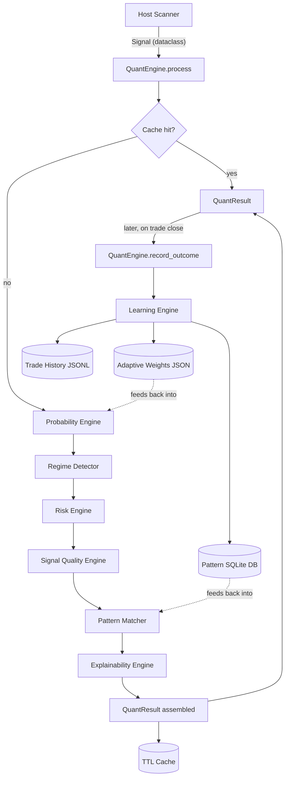
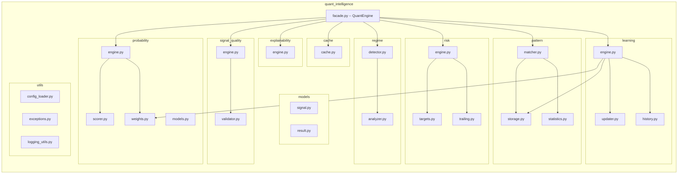
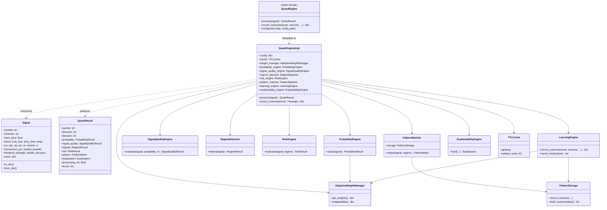

# Quant Intelligence Engine (Part 11)

An independent, self-contained Python module that adds probability
scoring, signal quality grading, market-regime classification, dynamic
risk management, historical pattern matching, rule-based learning, and
full explainability on top of signals produced by the existing NSE
Options Scanner.

**This module does not import from, modify, or depend on any file in
the existing scanner** (`scripts/`, `scripts/app/`, `scripts/production/`,
the Telegram/dashboard/API code, etc.). It is developed, tested, and
versioned entirely on its own. The scanner integrates it later with a
single two-line change (see [Integration Guide](#integration-guide)).

```python
from quant_intelligence import QuantEngine, Signal

signal = Signal(symbol="RELIANCE", direction="CE", spot_price=2500, ...)
result = QuantEngine.process(signal)

print(result.decision, result.signal_quality.grade, result.probability.probability)
```

---

## Table of contents

1. [Architecture diagram](#architecture-diagram)
2. [Component diagram](#component-diagram)
3. [Class diagram](#class-diagram)
4. [Installation](#installation)
5. [Usage examples](#usage-examples)
6. [Configuration guide](#configuration-guide)
7. [Integration guide](#integration-guide)
8. [Performance guide](#performance-guide)
9. [Testing](#testing)
10. [Pydantic note](#pydantic-note)
11. [Design decisions / trade-offs](#design-decisions--trade-offs)

---

## Architecture diagram



## Component diagram



## Class diagram



---

## Installation

The module has exactly one hard dependency: **PyYAML** (for
`config/settings.yaml`). No pydantic, no cloud SDKs, no paid services.

```bash
pip install -r requirements.txt
# or, to install the package itself (editable, for development):
pip install -e .
```

Directory layout:

```
quant_intelligence/
    __init__.py            # public API: QuantEngine, Signal, result types
    facade.py               # QuantEngine / QuantEngineImpl
    probability/            # adaptive probability engine
    signal_quality/         # A+..Reject grading
    regime/                 # market regime classification
    risk/                   # dynamic entry/SL/targets/RR
    pattern/                # local SQLite historical pattern DB
    learning/               # rule-based weight/pattern learning
    explainability/         # human-readable reasoning
    cache/                  # thread-safe TTL cache
    models/                 # Signal (input) / QuantResult (output)
    config/settings.yaml    # single source of configuration
    utils/                  # config loader, logging, exceptions
    tests/                  # unittest suite (70+ tests)
    data/                   # created at runtime: patterns.db,
                            # trade_history.jsonl, adaptive_weights.json
```

---

## Usage examples

### Minimal

```python
from quant_intelligence import QuantEngine, Signal

signal = Signal(
    symbol="RELIANCE",
    direction="CE",
    spot_price=2500.0,
    option_price=45.5,
    trend="UP",
    ema_fast=2505.0,
    ema_slow=2490.0,
    vwap=2495.0,
    adx=28.0,
    atr=18.0,
    volume=50000.0,
    avg_volume=30000.0,
    momentum_pct=0.6,
)

result = QuantEngine.process(signal)

print(result.decision)                    # "SELECTED" | "WATCH" | "REJECTED"
print(result.signal_quality.grade)         # "A+".."C" or "Reject"
print(result.probability.probability)      # 0-100
print(result.risk.entry, result.risk.stop_loss, result.risk.target_1)
print(result.explanation.summary)          # human-readable one-paragraph summary
```

### Recording an outcome (closes the learning loop)

```python
# ... later, once the trade is closed ...
QuantEngine.record_outcome(
    result,
    outcome="WIN",              # "WIN" | "LOSS" | "BREAKEVEN"
    exit_price=71.0,
    pnl=2550.0,
    duration_seconds=1800,
    target_hit="T1",
)
```

This updates, in this order: the trade history log, the local pattern
database (so future `QuantEngine.process()` calls on similar setups see
an updated win/loss sample), and the adaptive probability weights.

### Full dict round-trip (typical scanner integration shape)

```python
from quant_intelligence import QuantEngine, Signal

scanner_trade_dict = {
    "symbol": "NIFTY",
    "direction": "PE",
    "spot_price": 24800,
    "option_price": 120.5,
    "trend": "DOWN",
    "ema_fast": 24790, "ema_slow": 24810,
    "adx": 32, "atr": 55, "volume": 80000, "avg_volume": 40000,
    "some_field_scanner_added_later": "ignored-safely",
}

signal = Signal.from_dict(scanner_trade_dict)   # unknown keys -> signal.extra
result = QuantEngine.process(signal)
```

### Inspecting why a signal was rejected

```python
result = QuantEngine.process(signal)
if result.decision == "REJECTED":
    for reason in result.signal_quality.reasons:
        print("-", reason)
    print(result.explanation.summary)
```

---

## Configuration guide

Everything tunable lives in `config/settings.yaml`. Key sections:

| Section | Purpose |
|---|---|
| `engines.*.enabled` | Turn any engine on/off independently. Disabled engines return a clearly-labeled neutral result instead of crashing the pipeline. |
| `probability.seed_weights` | Starting factor weights (sum to 1.0). Only used the *first* time the module runs -- after that, the persisted `adaptive_weights.json` takes over and is nudged by `learning`. |
| `probability.learning_rate` | How aggressively `record_outcome()` nudges weights. Lower = more stable, slower to adapt. |
| `probability.confidence_bands` | Probability-to-label thresholds (VERY LOW..VERY HIGH). |
| `signal_quality.grade_thresholds` | Quality-score cutoffs for A+/A/B+/B/C. Below `C`'s threshold, or any hard-fail check (late entry, weak momentum/volume, poor liquidity, false breakout, poor RR, low confidence) -> `Reject`. |
| `regime.*` | ADX/ATR/volume/gap thresholds used to classify the current market regime. |
| `risk.*` | ATR multipliers for stop loss and the three targets, trailing-stop activation, IV dampening, minimum stop distance floor. |
| `pattern.*` | Local SQLite path, minimum sample size before a pattern is "confident", how many similar patterns to pool when there's no exact match yet. |
| `learning.*` | Trade history / adaptive weights file paths and retention. |
| `cache.*` | TTL and max entries for the in-memory result cache. |

Loading is cached process-wide; call
`quant_intelligence.utils.config_loader.reload_config()` to force a
re-read (e.g. after editing the YAML during a long-running process), or
construct a `QuantEngineImpl(config=...)` directly with a fully custom
dict (see `tests/helpers.py::build_isolated_engine` for the pattern
used throughout the test suite).

---

## Integration guide

**Zero changes to existing scanner files are required to develop or
test this module.** When the scanner team is ready to wire it in,
integration is exactly this:

```python
# Anywhere the scanner already has a fully-scored trade dict/candidate
# (e.g. at the end of scanner.py's per-strike scoring, or right before
# telegram_notify.py formats an alert):

from quant_intelligence import QuantEngine, Signal

qi_signal = Signal.from_dict(existing_trade_dict)   # or construct explicitly
qi_result = QuantEngine.process(qi_signal)

# qi_result.decision, qi_result.signal_quality.grade,
# qi_result.risk.target_1/2/3, qi_result.explanation.summary
# are now available to fold into the existing alert/decision flow,
# entirely additively -- nothing existing has to be removed.
```

Recommended (also optional, no schema changes elsewhere): call
`QuantEngine.record_outcome(...)` from wherever the scanner already
learns a trade's final SL/target/exit, to close the learning loop.

No REST endpoints, no Flask/FastAPI app, no new ports -- `QuantEngine`
is a plain in-process Python object.

---

## Performance guide

- **Throughput**: `tests/test_performance.py::test_throughput_1000_signals_under_time_budget`
  processes 1000 signals well under a few seconds on a single thread --
  comfortably over the 1000+/day target.
- **Caching**: `QuantEngine.process()` results are cached (default TTL
  30s, `cache.default_ttl_seconds`) keyed on symbol+direction+strike+
  second-granularity timestamp, so repeated calls for the same
  candidate within one polling cycle don't re-run all six engines.
- **Thread safety**: `TTLCache`, `AdaptiveWeightManager`, and
  `PatternStorage` all guard their mutable state with `threading.Lock`;
  SQLite connections are opened per-call rather than shared, so
  concurrent readers/writers from a thread pool are safe (see
  `test_thread_safety_concurrent_processing` and
  `test_concurrent_learning_writes_do_not_corrupt_weights`).
  There is no `asyncio` code in this module, but every method is a
  plain synchronous function with no blocking I/O held under a lock
  for longer than a single dict/SQLite operation -- safe to call from
  `asyncio.to_thread(...)` / an executor from async code.
- **Low memory**: the cache is bounded (`cache.max_entries`, LRU
  eviction); trade history is a bounded, periodically-truncated JSONL
  file rather than an in-memory list.
- **Retry safety**: `QuantEngine.process()` performs no writes (other
  than the result cache) -- it is safe to call repeatedly/speculatively.
  Only `record_outcome()` writes durable state, and each of its three
  writes (history append, pattern insert, weight nudge+save) is
  independently idempotent-safe to retry (append/insert are pure
  additions; weight save is a full-file atomic replace via
  `os.replace`).

---

## Testing

```bash
python3 quant_intelligence/run_tests.py
```

70 tests across `tests/test_probability.py`, `test_signal_quality.py`,
`test_regime.py`, `test_risk.py`, `test_pattern.py`, `test_learning.py`,
`test_config.py`, `test_performance.py`, and `test_edge_cases.py`. Every
test that touches storage builds an isolated `QuantEngineImpl` pointed
at a fresh `tempfile.mkdtemp()` (see `tests/helpers.py`), so running
tests never reads or writes this module's real `data/` directory.

Built with stdlib `unittest` rather than `pytest` since this
environment has no network access to install `pytest`; the suite has no
`pytest`-specific features and will also run fine under `pytest` if
it's available in the deployment environment (`pip install pytest &&
pytest quant_intelligence/tests`).

---

## Pydantic note

The Part 11 spec calls for Pydantic. This sandbox had no network access
to install it, so `models/signal.py` and `models/result.py` are
implemented with stdlib `dataclasses` instead -- fully typed, zero
extra runtime dependency, and behaviorally equivalent for this
module's purposes (construction, `to_dict()`/`from_dict()`, defaults).

To switch to Pydantic later:

1. `pip install pydantic` and add it to `requirements.txt`.
2. Change `Signal` and the `*Result` dataclasses to `pydantic.BaseModel`
   subclasses (field names/types are already 1:1 with what you'd write
   in Pydantic).
3. `to_dict()` becomes `model_dump()`; `from_dict()` becomes
   `model_validate()`. Every call site in this module uses those two
   methods (or plain attribute access), not raw `dataclasses.asdict`
   elsewhere, so the blast radius of the swap is exactly these two
   files.

Nothing else in the module needs to change.

---

## Design decisions / trade-offs

- **Adaptive, not fixed, weights**: `probability/weights.py`'s
  `AdaptiveWeightManager` persists a weight vector on disk and nudges it
  via a bounded exponential-moving-average rule (`learning/updater.py`)
  after each `record_outcome()` call -- never a static dict.
- **Rule-based learning, not ML**: per the spec, there is no
  scikit-learn/torch/etc. dependency. The "learning" is: (a) adaptive
  weight nudging, and (b) a growing local pattern-outcome sample that
  naturally increases `pattern_confidence` as more history accumulates.
- **Fail-soft engine isolation**: `facade.py` wraps every sub-engine
  call in its own try/except. A single engine throwing never crashes
  `QuantEngine.process()` -- it substitutes a clearly-labeled neutral
  result and appends to `QuantResult.errors` for observability.
- **Local-only storage**: patterns live in a local SQLite file
  (`pattern/storage.py`), trade history in a local JSONL file
  (`learning/history.py`), weights in a local JSON file -- no cloud,
  no external services, as required.
